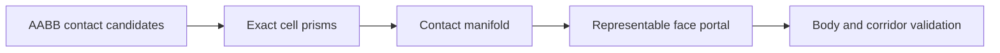

# Cell Geometry and Navigation

Start with [Core Concepts](Core-Concepts.md) for ownership and coordinates. Use
these exact geometry contracts when broad-phase neighbors are insufficient for a
portal or clearance decision.

## From candidates to a certificate

`GetNeighborsInto(...)` is deliberately a broad-phase candidate query: inclusive
cell AABBs can admit contacts that only touch at a point, an edge, or an AABB
corner outside a hex footprint. Consumers that require portal or clearance
geometry use `GridCellGeometry` instead. `GridCellPrism` exposes the exact
boundary-ordered XZ footprint, vertical interval, and planar inradius for a
physical cell. `VoxelContactManifold` classifies exact prism contact as
`Separated`, `Point`, `Edge`, `Face`, or `VolumeOverlap`; only a representable
positive-area `Face` is an automatic-portal candidate before agent-specific
clearance checks. `TryCreateNavigationPortal(...)` compiles that face into an
agent-independent `GridNavigationPortal` with conservative fixed-point radius
and height capacity; its constant-time profile resolution returns directed foot
anchors without retaining or querying live grid state.

## Body clearance and endpoint allowances

`IsNavigationBodySegmentValid(...)` is the allocation-free swept-body clearance
authority. It compares the exact XZ capsule against every blocked wall span,
uses the full retained contact segment as the physical aperture, and applies
each selected portal's vertical band only while the sweep overlaps that
aperture. Its required endpoint allowance may admit one exact, directed entry or
exit through a vertical footprint edge. GridForge derives and clips that
boundary from the original segment; callers never reconstruct a rounded contact
or supply an epsilon. Vertices, collinear travel, horizontal top/bottom
crossings, and degenerate boundary segments fail closed. Tangency is accepted;
one-raw penetration is rejected. `IsNavigationBodyAnchorValid(...)` is its
degenerate-segment form.

## Directed portal traversal

`TryGetNavigationPortalTraversalParameters(...)` additionally revalidates a
directed portal against both authored prisms. Vertical crossings return a
source/target parameter enclosure whose reconstructed endpoints are certified in
the corresponding prisms. Horizontal crossings return ordered parameters; the
exact profile anchors resolved from the portal remain the geometric authority
rather than points reconstructed from rounded parameters. Two selected openings
on one wall retain independent height bands. One segment is conservatively
rejected when it would need to switch vertical authority between those openings;
callers preserve an intermediate anchor instead.

## Incremental corridor validation

For longer authored corridors, `GridNavigationCorridorValidationCursor` advances
the same canonical portal, swept-clearance, and checked-cost certificate used by
`TryValidateNavigationCorridor(...)` in caller-budgeted, allocation-free work
units. After each one-unit advance, `TryGetCurrentPortal(...)` exposes the
portal certificate produced by that unit so callers can persist validated
adjacencies without recompiling them. Callers retain the ordered prism and
waypoint spans unchanged until the cursor reaches `Complete`, `Invalid`, or
`CostOverflow`.

## Cross-grid composition

`GetExactBoundaryContactsInto(...)` combines the existing range broad phase with
exact fixed-point narrow phase and accepts caller-owned result and scratch
containers for zero-allocation warmed composition work. World-wide composition
can instead reuse a caller-owned `GridBoundaryContactCursor`. Begin and advance
it through `GridWorld`; every chunk runs under the short navigation-maintenance
gate and independently caps candidate probes and emitted contacts. The cursor
walks a maintained exact contact-envelope index, canonical grid pairs, and
topology-configured addresses without retaining live grids or voxels. Sparse
physical absence is therefore a separate runtime state, not missing seam
geometry. `Stale` means a bound world, grid generation, or last committed change
sequence changed: discard all output from that run and begin again. `Complete`
remains bound and is revalidated by later advances, including zero-budget calls.

When only one active grid changed, `TryBeginBoundaryContacts(...)` resolves its
exact `GridConfigurationKey` and restricts the same cursor to that grid's
incoming-lower and outgoing-higher incident pairs. A missing key returns false
and leaves the cursor `Stale`. The `GridBoundaryContact` output overload carries
both normalized grid keys, while `cursor.RunStamp` lets callers reject contacts
captured across different committed world revisions.

Prism construction fails closed when a normalized cell metric cannot be bisected
exactly in the fixed-point scalar domain; this prevents a rounded half extent
from turning a native shared face into a gap or volume overlap.

## Segment evidence

`GridTracer.TraceIntervalsInto(...)` is the exact navigation-facing segment
query. It reports normalized grid binding plus exact runtime generation and
address identity, the traced grid generation's last committed change sequence,
physical presence for sparse addresses, closed `tEnter` and `tExit` prism
intervals, and deterministic simultaneous-coverage groups. A tie group describes
overlapping interval coverage only; its peer cells are not implicitly adjacent.

The report separately proves continuous address and physical coverage, and
reports separate candidate-grid, candidate-address, and output counts and
ceilings. A grid-ceiling failure stops before address enumeration.
`GridCandidateCount` and `AddressCandidateCount` preserve the exact completed
work, while `GridCandidateLimitExceeded` and `AddressCandidateLimitExceeded`
identify which ceiling stopped the query. The required combined candidate-work
ceiling independently bounds the sum of accepted grids and addresses;
`CandidateWorkLimitExceeded` stops before the next unit while preserving the two
exact completed counts. Individual ceilings win when they coincide with the
combined limit.

Caller-owned results and `GridTraceIntervalScratch` retain capacity for
zero-allocation warmed traces. The complete trace holds one world read lease, so
grid removal and slot reuse cannot change identity. It enumerates the topology
candidate range under the caller's explicit budget, then snapshots sparse
physical-presence bits under a short change gate before running exact prism
clipping and sorting outside that gate. Dense traces and the expensive narrow
phase therefore do not serialize through the world change gate.

## Related guides

- [World Changes and Composition](World-Changes-and-Composition.md) for bounded
  world-wide contacts and change stamps.
- [Segment Intervals and Slabs](Segment-Intervals-and-Slabs.md) for interval
  budgets and slab observers.
- [Navigation Body Coverage](Navigation-Body-Coverage.md) for swept-body union
  evidence.
